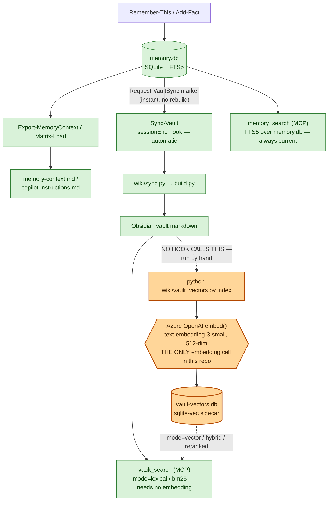

# Long-Term Memory for Copilot CLI, the Copilot app and Scout

Persistent, portable memory for your agents — a SQLite store, automatic session
capture, and an Obsidian vault with a live graph on top. **No daemon, no
required `pip install` for the base system, and it moves to a new machine.**

The repo carries machinery, never memory. `memory.db` lives under
`~/.copilot/`, **never in this repo** — a clone gives you an empty brain until
the hooks fill it or you restore a backup.

---

## How it works — three stages, not one

Everything downstream depends on which of three independent stages has run.
Confusing them is the most common cause of *"why can't it find the fact I just
saved"* — because the honest answer is often **it can, by keyword, but not yet
by meaning.**

| Stage | Command | Writes | Embeds? |
|---|---|---|---|
| 1. Capture a fact | `Remember-This` / `Add-Fact` | `memory.db` (SQLite + FTS5) | No |
| 2. Rebuild the wiki | `Sync-Vault` (→ `wiki/sync.py`) | Obsidian vault markdown | No |
| 3. Build the vector index | `python wiki\vault_vectors.py index` | `vault-vectors.db` sidecar | **Yes — the only embedding step in this repo** |



Green = no embedding call anywhere on that path. Orange = the one place this
repo talks to Azure OpenAI.

**Evidence** (verified against the code, not the old docs, which did not make
this clear):

- `core/memory_driver.py` — the stage-1 backend — imports only
  `json, sys, sqlite3, os, io, re, datetime`. It cannot embed anything.
- `Add-Fact` / `Remember-This` call `Request-VaultSync`, whose own docstring
  says *"Cheap — writes a marker only."* The actual wiki rebuild runs later, at
  `Sync-Vault`, `Export-MemoryContext`, `Matrix-Load`, or the `sessionEnd` hook.
- `wiki/sync.py` — what stage 2 calls — has **zero** references to
  `vault_vectors`, `vault_embed`, or `embed` anywhere in the file.
- **No hook runs stage 3.** `hooks/ltm_session_end.py` calls
  `sync_obsidian_vault()`, which only ever invokes `wiki/sync.py` — never
  `vault_vectors.py`. `hooks/ltm_session_start.py` imports `vault_embed` for
  exactly one reason: to read `token_status()`, a cached-file check that warns
  you when `az login` has lapsed. It never calls `embed()`.

**The consequence, plainly stated:** a fact captured today is immediately
findable by keyword (`memory_search`, FTS5 — always current) but **semantically
invisible** — absent from `vault_search`'s vector and hybrid results — until
someone manually runs `python wiki\vault_vectors.py index`. Nothing schedules
that command. If you want new knowledge to be reachable by paraphrase, not just
by matching words, you have to run it yourself.

---

## Prerequisites

- **Windows, PowerShell, git, Python 3.10+.**
- **Nothing to `pip install`.** This is the repo's best property and nobody
  believes it unless told directly: `core/memory_driver.py` and every op it
  dispatches use only the standard library. `pyyaml` is the *one* repo-level
  third-party import, in `wiki/check_frontmatter.py`, guarded by `try/except`
  — the frontmatter linter just skips its YAML check when it is absent.
- **Optional: `sqlite-vec`** (`pip install sqlite-vec` — the only pip
  dependency anywhere in this repo, and it is optional). Without it, every
  retrieval path degrades cleanly to lexical search. Nothing breaks; nothing
  even needs to be configured.
- **Optional: an embedding model**, for semantic search. Currently
  `text-embedding-3-small` at **512 dimensions** (a Matryoshka truncation of
  1536 — MTEB 61.6 vs 62.3, for a sidecar 3x smaller), reached through an
  Azure OpenAI endpoint resolved from `wiki/config.py`, authenticated by your
  own `az login` — there is no API key to manage. The token is read via
  `az account get-access-token` and cached to disk with its expiry, so the
  session-start hook can check it in under a millisecond instead of paying the
  ~1-2 s cost of shelling out to `az` on every session. Live scale measured
  today: **8,279 chunks across 648 pages** (`python wiki\vault_vectors.py
  status`). **This degrades silently by design**: when the cached token has
  expired, `embed()` returns `[]` rather than raising, and every caller falls
  back to lexical search without a warning at query time. The only place you
  are told is the next session start, and only if semantic search was ever
  configured. Diagnose the state with:
  ```powershell
  python wiki\vault_vectors.py status
  az login
  ```
- **The five path env vars** — `COPILOT_HOME`, `LTM_WIKI_VAULT`,
  `LTM_MEMORY_DB`, `LTM_SESSION_DB`, `LTM_WIKI_WORKSPACE` — resolve through
  `wiki/config.py` in the order **argument → env var → `~/.copilot/wiki-config.json`
  → default**. Nothing here is machine-specific; check what a given machine
  resolves to with `python wiki\config.py`.
- **Set your identity.** There is no `identity` table — the Identity block in
  the bridge is rendered from the one `entities` row with `is_self = 1`.
  Skip `Set-Identity` and the bridge silently renders **no** identity section
  at all — no error, just an absence, which is the most common "it doesn't
  work" report.
  ```powershell
  . .\memory.ps1
  Set-Identity -Name "Your Name"
  Export-MemoryContext
  ```
- **Run `migrate()` when upgrading an existing database.** No installer calls
  it automatically.
  ```powershell
  . .\memory.ps1
  Invoke-MemoryMigration
  ```

---

## Install

```powershell
git clone https://github.com/vijaycinn/long-term-memory.git
Set-Location .\long-term-memory
.\setup\install-memory.ps1      # DB, session hooks, context bridge, instructions
.\setup\install-wiki.ps1        # Obsidian vault, graph, MCP server (optional)
.\setup\install-scout.ps1       # same memory inside Microsoft Scout (optional)
```

Both installers are idempotent — safe to re-run — and preserve every hook or
setting they did not write themselves. Restart the harness afterward; MCP
tools and hooks only load at session start.

**Cloning with more than one GitHub account signed in.** `gh` uses its active
account for git credentials, so a private clone can fail with
`Repository not found` even though the repository exists and you have access —
GitHub returns the same 404 for "doesn't exist" and "you can't see this."
Check first, don't debug the URL:

```powershell
gh auth status
gh auth switch --user <owner-of-the-fork-you-are-cloning>
```

For the full walkthrough — path selection, hook-registration internals,
troubleshooting table, and the Scout-specific steps — see
[`docs/INSTALL-PEER.md`](docs/INSTALL-PEER.md). For the complete op surface,
data model, and every defect already fixed (do not reintroduce them), see
[`CAPABILITIES.md`](CAPABILITIES.md).

### Where it works

| | Copilot CLI / app | Scout |
|---|---|---|
| Read memory via MCP | Yes | Yes, after `install-scout.ps1` + a Refresh |
| Write with `Remember-This` | Yes | Yes — Scout has a shell |
| **Automatic session capture** | **Yes** | **No — Scout fires no session hooks** |

Scout is **read-first**: everything recorded is searchable there, but nothing
new is captured for you. Keep a Copilot CLI session in play for capture to
stay automatic. Scout's own memory (`m-memory.json`) is a separate, unrelated
store — linear, capped at 500 entries with 60-day decay, and encrypted at
rest — so this system runs *alongside* it, not instead of it.

**Already have an Obsidian vault?** `install-wiki.ps1` reuses it rather than
creating a second one, and only rebuilds notes stamped `origin: memory` —
anything hand-authored is left untouched. Pass `-Vault <path>` if yours is not
at the default location; detection deliberately does not go hunting for one.

---

## Commands

### Everyday

The day-to-day surface is typically one or two words.

| Command | When you'd run it |
|---|---|
| `Remember-This -Content "..."` | Save a durable fact or preference now |
| `Search-Memory -Query "..."` | Find a fact by keyword — works even with no vault built |
| `Sync-Vault` | Force the wiki to catch up with memory right now, instead of waiting for the next natural boundary |
| `Export-MemoryContext` | Refresh `memory-context.md` — the bridge an agent reads at session start |
| `Matrix-Load` | Pull shared memory into the *current* turn mid-session |

### Occasional / maintenance

| Command | When you'd run it |
|---|---|
| `python wiki\vault_vectors.py index` | Make today's writes semantically searchable — **the only step that talks to Azure OpenAI**. Nothing schedules this; you decide when |
| `python wiki\vault_vectors.py index --contextual` | Same, prepending a deterministic "where this chunk lives" header before embedding. Now the recommended way to index — a 15-query GCC/Content-Understanding litmus improved Hit@1 **7/15 → 10/15** and MRR **0.56 → 0.75** with zero regressions. Reported by the vault owner on 2026-09-02; not independently reproduced for this README — rerun `ops\retrieval_bench.py --compare-vectors A.db B.db` to check it against your own corpus. The CLI flag itself still defaults to off (`action="store_true"`, no default), so pass it explicitly |
| `python wiki\vault_vectors.py status` | Diagnose semantic search — sidecar size, chunk/page counts, whether `sqlite-vec` and an endpoint are configured |
| `python ops\backfill_entity_mentions.py --dry-run` / `--apply` | Populate `related_facts` cross-links on a database that predates the entity-edge backfill (or never ran it). `--apply` backs up first |
| `python ops\retrieval_bench.py --baseline OUT.json --paths vault_current --json` | Measure retrieval quality against the golden query set after a change to ranking, chunking, or the corpus |

> ⚠️ **Back up the sidecar before any `index` operation.** `--limit-pages`
> (added for smoke-testing on a large vault) used to treat every chunk outside
> its limited page slice as stale and delete it — it wiped a live 619-page
> index down to 33 pages in a session on 2026-09-02, costing roughly 40
> minutes of re-embedding to recover. That specific defect is now fixed and
> covered by a regression test
> (`test_limited_index_preserves_out_of_scope_chunks`), but the sidecar is
> excluded from git (`*.db` in `.gitignore`) and rebuilding costs real time and
> a few cents — copy `vault-vectors.db` somewhere before a large rebuild
> regardless of which flags you pass.

### Tests

```powershell
$env:PYTHONIOENCODING = "utf-8"
python -W ignore::ResourceWarning -m unittest discover -s tests -p "test_*.py" -t tests
python wiki\test_bootstrap.py
python wiki\test_vault_mcp.py
```

All three ran clean while writing this README: **265 tests** (`unittest
discover`), plus the two standalone harnesses — `test_bootstrap.py` stands up
empty / memory-only / full modes from nothing in a temp directory, and
`test_vault_mcp.py` drives the MCP server over real stdio JSON-RPC. Treat the
live output as ground truth over any test count quoted in prose anywhere,
including this file — the suite grows too fast for a written number to stay
correct for long.

---

## Retrieval quality — measured, not assumed

The golden query set (`tests/golden/queries.json`) was rebuilt on 2026-09-02
after an audit found its `paraphrase` class was **synthetic** — fabricated
queries with no match anywhere in real usage, not derived from it. Every query
now traces to a verbatim quote from a real `session-store.db` user message,
recorded per-query in [`tests/golden/provenance.json`](tests/golden/provenance.json)
and enforced by `test_retrieval_bench.py::test_repository_provenance_covers_every_query`
— a query without a provenance record fails the suite. A domain-weighting pass
then added nine GCC / Content-Understanding-cost queries, so the set is now
**36 queries**: 14 `local`, 3 `multihop`, 19 `paraphrase`.

Freshly measured against that set, on the live 648-page / 8,279-chunk index,
by running `ops\retrieval_bench.py --paths vault_current --json` while writing
this README:

| Class | Queries | Recall@5 | Recall@10 | Recall@20 | MRR |
|---|---:|---:|---:|---:|---:|
| Overall | 36 | 0.722 (26/36) | 0.750 | 0.833 | 0.490 |
| `local` | 14 | 0.929 (13/14) | 0.929 | 1.000 | 0.810 |
| `multihop` | 3 | 1.000 (3/3) | 1.000 | 1.000 | 0.400 |
| `paraphrase` | 19 | 0.526 (10/19) | 0.579 | 0.684 | 0.269 |

Paraphrase — queries worded differently from the page they target — is the
hard class and remains the weakest by a wide margin, exactly as expected: it
is the one thing lexical matching structurally cannot do, which is the reason
the vector sidecar exists at all. Re-run the same command yourself before
trusting this table for a decision; retrieval code in this repo is under
active tuning and this number moves.

---

## The knowledge wiki

Memory answers *"what do I know about X"* one fact at a time — enough for the
~40-fact bridge, but it does not accumulate: nothing links a fact about an
account to the research that produced it, or the session where the decision
was made.

`wiki/` compiles memory, the session store, and an optional source workspace
into a persistent, cross-referenced Obsidian vault, following
[Karpathy's LLM-wiki pattern](https://gist.github.com/karpathy/442a6bf555914893e9891c11519de94f):
knowledge is compiled once and kept current, rather than re-derived on every
question. **You do not need Obsidian** — the vault is plain markdown, and the
primary query path, `memory_search`, is FTS5 straight against `memory.db` and
works before any vault exists. Obsidian adds the graph, backlinks and Bases
views on top.

**Three modes**, decided purely by what exists on disk: `empty` (no
`memory.db` — tools report the gap and exit cleanly), `memory-only` (a
database, no source workspace — a complete wiki: topics, entities, learnings,
sessions), `full` (plus workspace documents, classified and imported
alongside). Proven end to end by `wiki\test_bootstrap.py` in a temp directory.

**Staying in sync.** `Add-Fact`, `Remember-This`, `Add-Topic`, `Add-Entity`,
`Add-Snapshot` and `Set-Identity` all drop a dirty marker instantly; the
rebuild itself runs at the next natural boundary — `Sync-Vault`,
`Export-MemoryContext`, `Matrix-Load`, or the `sessionEnd` hook. This is stage
2 of the pipeline above, and it still never embeds anything.

```powershell
Sync-Vault           # incremental — memory + sessions (~7s)
Sync-Vault -Full     # also rescan the source workspace (~10s)
Sync-Vault -Status   # what would happen, changes nothing
```

> Incremental sync does **not** see new or changed workspace files. Run
> `Sync-Vault -Full` after adding documents.

**What you may edit.** Every generated page carries `generated: true` plus an
`origin`; the builder deletes and recreates exactly those. Anything you write
by hand — or file back with `python wiki\wiki.py file-answer "Title"
--body-file a.md` — survives every rebuild untouched. Filing an analysis back
is what makes the wiki compound instead of plateau; an analysis left only in
chat history is lost.

**Querying, without an agent harness:**

```powershell
cd wiki
python wiki.py search "term"                        # ranked lookup with summaries
python wiki.py ingest article.md --title "..."       # register a source, cross-reference it
python wiki.py file-answer "Title" --body-file a.md  # file an answer back
python wiki.py recent                                # what changed lately
```

> **Do not commit `vault-vectors.db`.** `.gitignore` excludes all `*.db` on
> purpose. The BM25 index inside the sidecar stores the **full text** of every
> chunk — on this vault, tens of millions of recoverable characters including
> customer and HR-sensitive material. It is a plaintext copy of the vault
> wearing a binary extension.

---

## Two stores, one memory

Copilot exposes its own `store_memory` tool. It writes to the harness's own
memory service — **not** to `memory.db` — so anything saved that way is
invisible to the bridge at the next session start, while everything written
with `Add-Fact` is invisible to the harness. Two stores drift apart in
silence, and each looks perfectly healthy on its own.

Every `store_memory` call is, however, recorded locally in
`~/.copilot/session-state/<id>/events.jsonl`. `Sync-AgentMemory` replays them
into SQLite so both paths converge:

```powershell
Sync-AgentMemory -WhatIf        # preview: what would be imported
Sync-AgentMemory                # last 48h — runs automatically at session end
Sync-AgentMemory -SinceHours 0  # full historical backfill
```

Idempotent (dedup on `topic, content`), honours retractions (a fact later
downvoted with `vote_memory` is marked `superseded`, never resurrected), and
preserves the memory's real timestamp rather than the import time — otherwise
every imported topic would look freshly used and push live work out of the
bridge.

---

## Layout

```
memory.ps1        the entry point you dot-source — Add-Fact, Search-Memory,
                   Remember-This, Matrix-Load, Backup-Memory, Sync-Vault
CAPABILITIES.md    agent reference: op surface, invariants, fixed defects
setup/             everything that stands the system up
core/              the storage engine — memory_driver.py, export, restore
hooks/             session lifecycle — sessionStart / sessionEnd
ops/               maintenance, reporting, continuity, retrieval benchmark
skills/            the agent-facing skill, for Copilot CLI and Scout
wiki/              the vault, the graph, the vector sidecar, and the MCP server
tests/             the suite, plus the golden query set and its provenance
docs/              install walkthrough, implementation notes, bench artifacts
copilot-config/    templates copied into ~/.copilot by the installers
```

Everything is standard-library Python and PowerShell — nothing here is
installed as a package, so cross-folder imports put sibling directories on
`sys.path` explicitly rather than relying on packaging.

---

## GitHub-friendly packaging

- **Commit:** code, setup scripts, docs, tests, the golden query set.
- **Never commit:** `memory.db`, `memory-context.md`, backup JSON,
  `vault-vectors.db` — all excluded by `.gitignore`, and each one is either
  personal data or a rebuildable derivative.
- **Migrate your own memory** with `python core\memory_export.py` /
  `python core\memory_restore.py <backup.json>` — see
  [`docs/INSTALL-PEER.md`](docs/INSTALL-PEER.md) for the full matrix-move
  walkthrough between machines.

Repo = reusable capability. `memory.db` = your private brain. They never mix.
